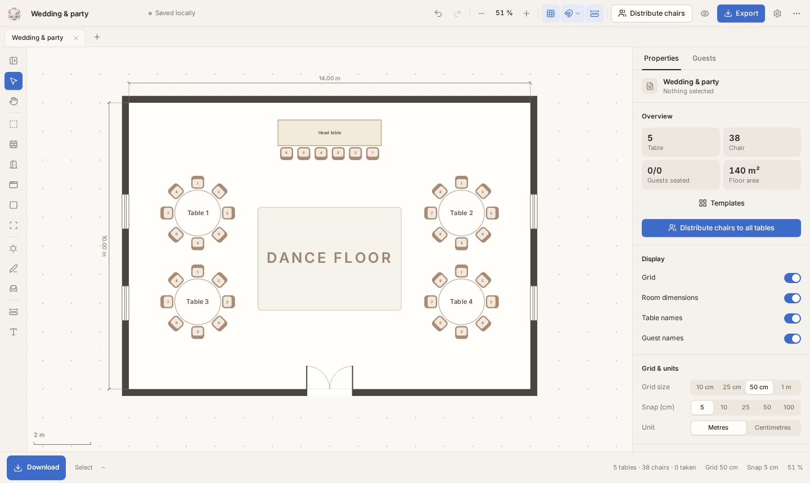

# Seatsketch Studio

Sketch a room, draw tables, arrange chairs and seat your guests. Export to PDF, PNG, SVG or CSV.
Your plans stay on your device, with no account, backend or telemetry.

[Open the editor](https://seatsketch.pixel-cursor.com) · [Windows & Linux downloads](https://exporthub.pixel-cursor.com/download/seatsketch)

The editor opens straight onto a blank canvas. Templates live in the optional properties sidebar;
the theme follows your system until you choose another. English is the default regardless of the
OS language; Settings → Language offers English, German, Spanish, Simplified Chinese and Hindi.
Explicit language and theme preferences are saved on this device.
Existing plans and guest names keep their original text. The web editor has a Download button in
the bottom-left corner; native builds omit it.

## Development

Node.js 24 and npm 12. Run `npm ci`, then `npx playwright install chromium` once.

| Command | Purpose |
| --- | --- |
| `npm run dev` | Browser development |
| `npm run electron:dev` | Desktop development |
| `npm run check` | TypeScript, unit and browser tests |
| `npm run build` | Production web bundle and library/font notices |
| `npm run dist` | Windows portable and Linux AppImage |
| `npm run dist:flatpak` | Linux Flatpak |
| `xvfb-run -a npm run test:desktop` | Packaged Electron integration test |
| `npm run verify:release` | Check archive, metadata and artifact hashes |
| `xvfb-run -a npm run release:all` | Complete release pipeline |
| `npm run clean` | Remove build/test output, preserving release files |

Flatpak builds require `flatpak`, `flatpak-builder >= 1.4`, `fakeroot`, `appstream-compose`, and the
Freedesktop Platform/SDK and Electron2 BaseApp on branch 25.08. See
[distribution notes](docs/DISTRIBUTION.md) for maintainer details.
The app uses Zypak and desktop file portals, without network, audio or home-directory access.
Its stable application ID is `de.endboss.seatsketch`.

Release files live outside Git in `release/` and on the [releases page](../../releases): three desktop packages, `SHA256SUMS` and
`release.json`. There is no bundled installation guide. These direct downloads are not a
Flathub publication. On Linux, the Windows artifact is checked for PE structure and packaged
content; a native Windows test still requires a Windows machine.

## Editor

- V select, H pan, R room, W wall, T table, P freehand table, C chair, A area, L text.
- Name an area in its properties, or double-click it. Choose an area, stage or no-go zone.
- Distribute chairs by table size; paste guest names one per line and fill empty seats.
- Drag to move; Ctrl temporarily disables snapping, Shift constrains direction.
- Space + drag or middle mouse pans; the wheel zooms. Press `?` for shortcuts.
- Work is autosaved to the local library. Saving a `.seatsketch` file is a separate action.

## Structure

`src/geometry` works in metres; `state` owns document history; `editor` handles the canvas,
commands and input. `components` contains the interface; `persistence` owns the versioned project
format and local library; `export` produces SVG/PNG/PDF/CSV. `platforms` supplies web and native
file adapters, while `electron` owns the sandboxed desktop shell and validated file IPC.

MIT, Copyright PixelCursor. See [LICENSE](LICENSE). Builds include `THIRD_PARTY_NOTICES.txt`.
Product scope: [BUILD.md](BUILD.md). Architecture and maintainer notes: [CLAUDE.md](CLAUDE.md).
